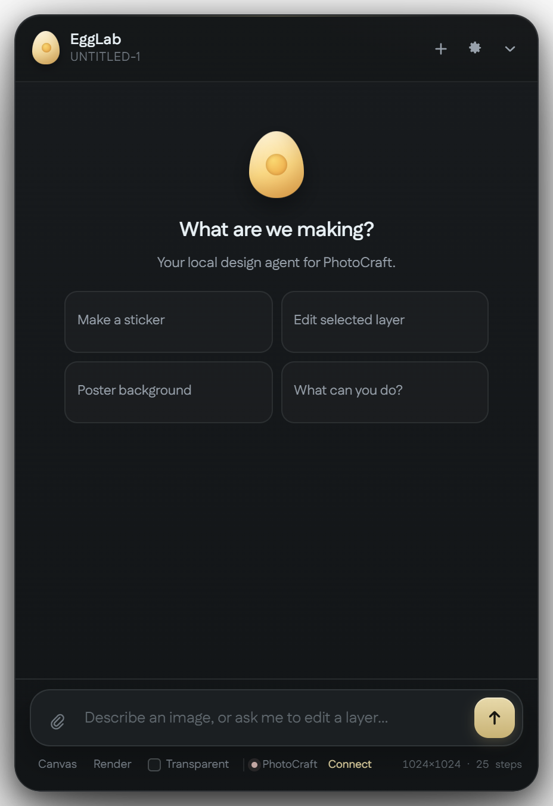
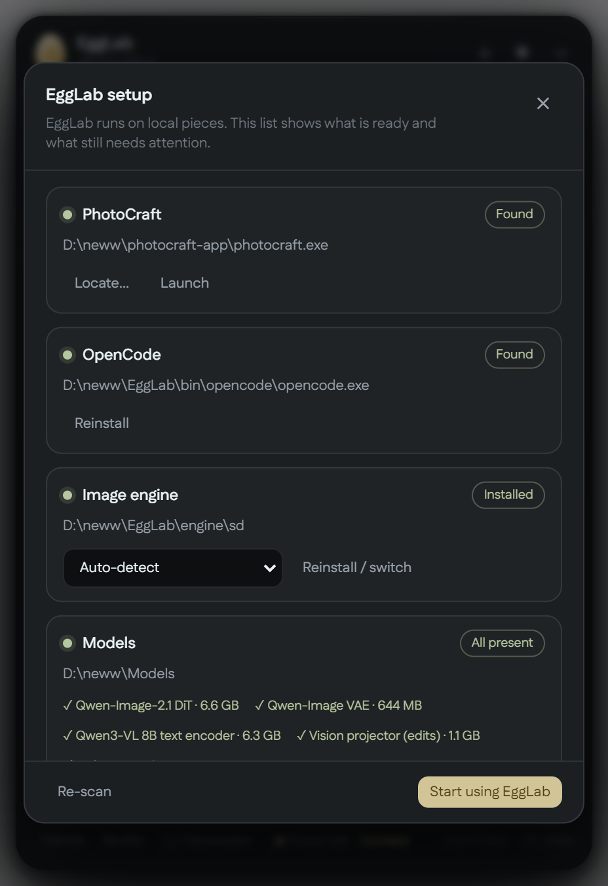

# EggLab

**Local AI image generation and editing for Windows.** A floating egg opens a design agent
for **PhotoCraft** — chat, generate, edit layers, and place results straight onto the canvas.

Everything runs on your own GPU: [Qwen-Image-2.1](https://huggingface.co/Qwen) on
[stable-diffusion.cpp](https://github.com/leejet/stable-diffusion.cpp). No ComfyUI, no
Python, no cloud rendering.



## What it can do

- **Chat with a design agent** that knows PhotoCraft: layers, masks, text, exports.
- **Generate images** (quality 40-step or turbo 8-step LoRA) at up to 2048 px.
- **Edit images** — reference photos, multi-reference compositions, transparent cut-outs.
- **Place results** on the PhotoCraft canvas as layers, or export flat/layered files.
- **Local-first** — models and renders stay on your disk; only chat text goes to the model
  provider you pick.

## Requirements

- Windows 10 or 11 (x64)
- **PhotoCraft** installed (the canvas app EggLab drives — not bundled)
- ~25 GB free disk: engine (17 MB–1.5 GB depending on GPU) + models (~20 GB, your choice)
- A GPU is strongly recommended:
  - NVIDIA → CUDA engine (fastest, ~1.4 GB download)
  - Any DX12 GPU → Vulkan engine (~29 MB)
  - CPU works but is slow
- Internet for the engine download and the model downloads

## Install

1. Download **`EggLab-Setup-<version>.exe`** from [Releases](../../releases).
2. Windows SmartScreen will warn because the installer is not code-signed yet:
   **More info → Run anyway**.
3. The installer copies the app (~77 MB) and downloads the engine that matches your GPU
   (SHA-256 verified, resumable; CUDA → Vulkan → CPU fallback if a download fails).
4. Launch EggLab and finish the setup wizard (below).

`SHA256SUMS.txt` is attached to every release if you want to verify the download:

```powershell
Get-FileHash .\EggLab-Setup-0.1.0.exe -Algorithm SHA256
```

## First run



The wizard checks the four pieces EggLab needs:

| Piece | What it is | What the wizard does |
|---|---|---|
| **PhotoCraft** | The canvas app | Detects it, or lets you locate `photocraft.exe` |
| **OpenCode** | The agent runtime | Detects an existing install, or downloads the standalone build (~78 MB) |
| **Engine** | stable-diffusion.cpp | Usually installed already; can re-download and switch GPU variant |
| **Models** | Qwen-Image-2.1 + VAE + text encoder + turbo LoRA | Downloads missing files (resumable) or imports files you already have |

After that, open **Settings** and pick a chat model under **Agent model**. EggLab uses
your OpenCode providers — the free models that ship with OpenCode work, and paid
providers/API keys are configured inside OpenCode itself.

## Auto-update

Installed copies check the GitHub releases of this repository about 12 seconds after launch
and every 6 hours after that. Updates download in the background and ask for a restart;
chats, settings, models and the engine are kept. You can also trigger a check from
**Settings → Check for updates**.

## Where things live

| Path | Contents |
|---|---|
| `%LOCALAPPDATA%\Programs\egglab` | Program files |
| `%LOCALAPPDATA%\EggLab\engine` | Image engine (downloaded, never packaged) |
| `%LOCALAPPDATA%\EggLab\models` | Models — or the folder you choose |
| `%APPDATA%\EggLab` | Chats, settings, logs, renders (`out`) |

Uninstalling removes the app and the engine, keeps your chats/settings, and asks before
deleting models.

## Build from source

```powershell
cd panel
npm install
npm start          # dev panel (uses the repo checkout layout)
npm run dist       # one-click installer in ..\dist
```

Node 20+ is required for development only; the released installer needs nothing but Windows.

Releases are published by pushing a `v*` tag — see
[`.github/workflows/release.yml`](.github/workflows/release.yml). Locally:

```powershell
cd panel
$env:GH_TOKEN = "..."   # a token with repo scope
npm run dist -- --publish always
```

## Project layout

```
egglab.ps1              engine runner (text-to-image, edit, turbo)
panel/                  Electron panel + agent + service layer
panel/build/            NSIS customization + engine downloader
panel/service/          settings, engine, chat, models, setup, updater
panel/knowledge (skills, references, templates)
```

## License

MIT — see [LICENSE](LICENSE).
